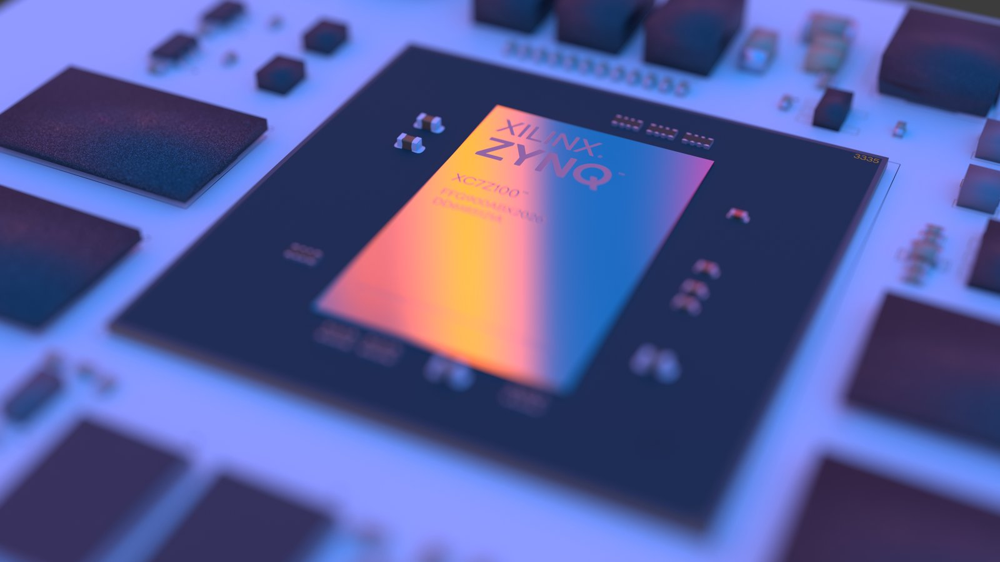
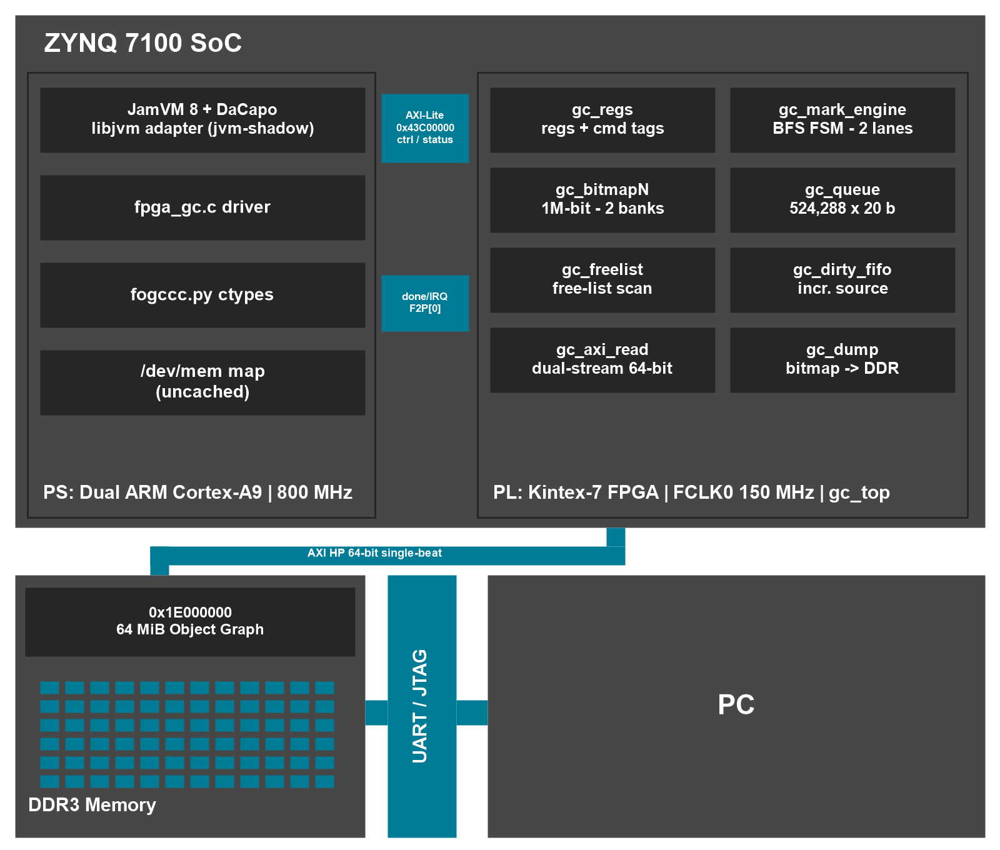

<h1 align="center">FPGA Offload GC Coprocessor（FOGCCC）</h1>

<p align="center">
  <a href="#1-结果"></a>
  <a href="#3-设计与接口"></a>
  <a href="docs/build.md"></a>
  <a href="#7-license"></a>
  <a href="https://github.com/HiEq/FPGA-Offload-GC-Coprocessor/actions/workflows/lint.yml"></a>
  <a href="https://github.com/HiEq/FPGA-Offload-GC-Coprocessor/releases/tag/v5.0"></a>
</p>

<p align="center">
  
</p>

<p align="center">
  <b>面向托管堆的 FPGA GC 协处理器（Zynq-7000 原型）</b><br>
  <sub>语义解耦旁表 · 多流乱序访存协处理器 · 扁平化数据流标记引擎</sub>
</p>

<table>
<tr>
<td valign="top" width="38%">
<p><b>系统构成</b></p>
<ul>
<li><b>语义解耦旁表</b>：对象体留在 DDR，引用关系整理为连续旁表，标记只读旁表。</li>
<li><b>多流乱序访存协处理器</b>：两条 AXI HP 读流并发预取对象头与引用，合计 8 笔未完成读。</li>
<li><b>扁平化数据流标记引擎</b>：根集、广度优先队列与脏引用汇入同一条取数—判位—入队流水。</li>
<li><b>JamVM 适配器</b>：宿主对象图导出为连续旁表，硬件标记位图按 id 导入 JVM 标记位，不改 JVM 核心。</li>
</ul>
<p>标记与空闲扫描由 PL 完成，建图、启动与回收决策由 PS 负责。</p>
<p>对象数上限 1,048,576、图区上限 64 MiB；已通过 JamVM 适配器接入真实 DaCapo 负载，标记在 PL、建图/启动/回收决策在 PS，回收仍为全局暂停（STW）。当前发布 v5.0（2026-11-08）。</p>
</td>
<td valign="top" width="62%">
<a href="docs/images/block.png"></a>
</td>
</tr>
</table>

| 文档 | 内容 |
| --- | --- |
| [构建与目录](docs/build.md) | 工具链、构建步骤、仓库布局 |
| [上板与串口](docs/board-usage.md) | 烧录、卡布局、板上测试 |
| [测量口径](docs/measurement.md) | 测量条件、规模扫描、证据边界 |
| [设计与协议](docs/design-details.md) | 旁表、读通路、脏引用协议 |
| [证据日志](tools/logs/README.md) | 逐条命令、位流与镜像哈希 |
| [JVM 适配器](docs/jvm-adapter.md) | 构建、运行参数、1M STW 与 DaCapo 结果 |

CI 只做静态检查与定向仿真，**不做** Vivado 综合/实现、xsim、PetaLinux 或上板。

---

## 1. 结果

| 对比对象 | 测量条件 | 每对象 | FPGA 加速比 |
|---|:---|---:|---:|
| **FPGA 标记**（fpga_vs_c_vs_python.py）| 同一张图，4000 对象 | **171 ns** | — |
| C，非预取（逐条读 DDR）| 同一张图、同一 BFS | 541 ns | **≈3.2×** |
| C，缓存友好（堆副本）| 堆上的副本 | 164 ns | **≈1.0×** |
| Python 脚本 BFS（逐条读 /dev/mem）| 同一张图 | 37.9 µs | **≈220×** |

FPGA 列只计标记引擎时间（周期计数；171 ns / 164 ns 为 100 MHz 历史数据），不含建图与驱动开销；171 ns 以已标记的 3766 个对象为分母。结果限于当前位流的 1,048,576 对象 / 64 MiB 图、单层 DDR；规模扫描、端到端成本与证据边界见 [docs/measurement.md](docs/measurement.md)。

C/DMA 建图把 4000 对象的建图从 102.2 ms 降到 2.0–5.4 ms，端到端 2.7–6.0 ms（17–38×）；命令、脚本与逐条日志见 [tools/build_routes/README.md](tools/build_routes/README.md)。

---

## 2. 快速开始

```bash
# 位流（PC）
vivado -mode batch -source vivado/build.tcl

# 板上二进制（PC，PetaLinux SDK）
SDK_ENV=<sdk> ./csrc/build_c_bins.sh
SDK_ENV=<sdk> ./csrc/build_routes/build_c.sh
SDK_ENV=<sdk> KERNEL_BUILD=<linux build dir> ./csrc/build_routes/build_dma.sh
```

```sh
# 板上自检（USERDATA 根目录）
sh fpga_vs_python.sh 4096 8 2
sh fpga_build_routes.sh

# 宿主回归
python -m unittest discover -s tests -p "test_*.py"
```

完整构建、烧录、串口与上板步骤见 [docs/build.md](docs/build.md)、[docs/board-usage.md](docs/board-usage.md)。

---

## 3. 设计与接口

三个构件的分工见开头与 [docs/design-details.md](docs/design-details.md)；这里只列软件可见的寄存器与关键参数。

<details>
<summary><b>寄存器映射与关键参数（点击展开）</b></summary>

**寄存器映射**

| 偏移 | 名称 | R/W | 说明 |
|------|------|-----|------|
| 0x00 | CTRL | R/W | [0] start · [1] 保留 · [2] clear_q · [3] abort · [4] bm_keep（与 [0] 同一次写）· [5] dirty_flush（预置，下一次全量标记生效）· [31] done；**写时 WDATA[31:20] 必须为 0xA50** |
| 0x04 | OBJ_BASE | R/W | 对象图 DDR 物理地址 |
| 0x08 | OBJ_COUNT | R/W | 对象总数 |
| 0x0C | ROOT_COUNT | R/W | 根集数量（≤256）|
| 0x10 | MARKED | R | 标记对象数 |
| 0x14 | CYCLES | R | 硬件周期计数 |
| 0x18 | Q_HEAD | R | 队列头指针 |
| 0x1C | Q_TAIL | R | 队列尾指针 |
| 0x20 | STATUS | R | [0] 队列溢出 · [1] AXI 读错误 · [2] 引用失步 · [3] 坏对象头 · [4] 引擎空闲 · [5] 空闲链表扫描忙 · [6] 位图转储忙 · [7] 上次启动后完成过转储 |
| 0x24 | BM_ADDR | R/W | 位图探针字地址（0–32767，引擎空闲时有效） |
| 0x28 | BM_DATA | R | 位图探测数据（2 拍延迟；读后勿改 BM_ADDR）|
| 0x30 | MAGIC | R | 固定 0x47434343（"GCCC"）|
| 0x34 | VERSION | R | 固定 0x00070500（v5.0）|
| 0x38 | FREE_COUNT | R | 未标记对象数（标记完成后扫描，扫描期 STATUS[5]=1）|
| 0x3C | FREE_DATA | R | 读一次弹出一个 free 对象 ID |
| 0x40+ | ROOT_LIST | R/W | 根集 ID 数组（0x40–0x43F，最多 256 个）；读回用于写后校验 |
| 0x440 | DIRTY_PUSH | W/R | **W** 0xA5400000 \| (tag<<12) \| id（标记符 = WDATA[31:20]），tag 每次推送必须变化；**R** 当前 FIFO 占用 |
| 0x444 | DIRTY_STAT | R | [8:0] 占用 · [9] 溢出（粘滞）· [10] 待处理 · [19:16] 最后接受的 tag · [31:20] 最后接受的 id |
| 0x448 | DIRTY_DRAINED | R | 本轮已消费条数（每次 start 清零）|
| 0x44C | DIRTY_PUSHED | R | 自上次清空以来接受的条数 |
| 0x450 | DIRTY_POPPED | R | 自上次清空以来弹出的条数 |
| 0x454 | Q_HWM | R | 上一轮 BFS 队列峰值占用 |
| 0x458 | Q_HI | R | 队列占用 ≥64 的周期数（宽前沿）|

DIRTY_PUSH 用 0x440（根表止于 0x43F）；CTRL[5] 与 DIRTY_* 的完整契约见 [docs/design-details.md](docs/design-details.md)。

**关键参数**

| 参数 | 值 | 说明 |
| --- | --- | --- |
| MAXO | **8** | 未完成读上限，等于 PS7 S_AXI_HP0 的 NUM_READ_OUTSTANDING |
| QD | **80** | 每条流的命令/数据 FIFO 容量 |
| PD | **8** | 对象头暂存环深度 = 预取深度 |
| DQD | **16** | 引用描述符队列深度 |
| 对象上限 | **1048576** | 20 位 ID / 位图 1,048,576 位 / 队列 524,288 深 |
| AXI 协议 | **AXI3** | HP 口原生：ID_WIDTH=6、单拍、ARSIZE=3 |
| 流 ID | **0 = 引用, 1 = 对象头** | 同 ID 保序，异 ID 互不阻塞 |
| 时钟 | **FCLK0 = 150MHz** | 单时钟域，无 CDC；WNS +0.012 / WHS +0.056 |
| 位图 / 队列 | 1,048,576 bit（2 库）/ 524,288×20 | 1 Mb / 10 Mb |

</details>

---

## 4. 证据

| 项目 | 结果 |
|---|---|
| 标记正确性 | test_main 3/3、随机图 8/8、abort 11/11 |
| C/DMA 建图 | C_BUILD_RESULT OK、DMA_BUILD_RESULT OK、卡上 BUILD_ROUTES_DONE |
| 仿真 | 定向测试台全部通过；负控对修复前 RTL 失败 |

逐条日志、命令与判据见 [tools/logs/README.md](tools/logs/README.md)；仿真用例矩阵见 [docs/simulation.md](docs/simulation.md)。

---

## 5. 发布

当前版本 v5.0（1M 对象 / 64 MiB 图区 / 150 MHz）。下列资产为 v4.14 的引导镜像；v5.0 资产按 artifacts/README.md 重新打包后替换。v4.7 为另一个正式版，其余版本为 Pre-release 历史快照。BOOT.BIN 与 image.ub 不入库，随 Release 发布（再分发限制见 [NOTICE](NOTICE)）；两个 zip 分别解压到 BOOT 与 USERDATA 根目录。

<details>
<summary><b>SHA256（点击展开）</b></summary>

| 资产 | 大小 | SHA256 |
| --- | --- | --- |
| BOOT.BIN | 18,582,724 B | d20530bc3ddbfd01be9cacaeac30618d568b5ec6c180232dab64cf905a3898fd |
| image.ub | 47,762,547 B | c958eac9970c3a4ddeb333a98922169801b484c706bbd77cf6bc8cbfd29c329f |
| card-boot.zip | 5,176 B | 6844e8612cafca02cee44696ca6948ee345e1a2d2d11e7aaf77eac6a99764e6a |
| card-userdata.zip | 139,184 B | c3fa49376d0e75c60c939c8e3200b1961090f99476af452e53f2440fe3e38fd2 |

</details>

校验：四个资产与 SHA256SUMS.release 同目录，执行 `sha256sum -c SHA256SUMS.release`。各版本变更与限制见 [docs/releases.md](docs/releases.md)，卡布局与上电见 [docs/board-usage.md](docs/board-usage.md)。

---

## 6. 目录

选题指南 3.3.5.4 的推荐结构与本仓库的对应关系如下。本仓库未采用推荐目录名，按该节要求在此给出对照；所有目录名为小写英文，不含空格与中文字符。

| 指南推荐 | 本仓库 | 内容 |
| --- | --- | --- |
| README.md | README.md | 项目简介与复现步骤 |
| src/ | rtl/、csrc/、driver/、python/ | PL 源码、C 驱动与 test_main、C/DMA 建图验证、内核模块、ctypes 绑定 |
| sim/ | sim/ | 自检 testbench、定向用例、AXI 协议检查器 |
| build/ | vivado/、petalinux/、Makefile | 位流与镜像的构建脚本、综合与实现报告 |
| board/ | tools/、tools/logs/ | 串口与上板脚本、逐次实测日志 |
| data/ | artifacts/ | 卡上产物、二进制清单与校验值 |

tests/ 为仓库自身的契约测试（目录规范、提交信息、字面量基线），不属于上述结构。完整目录说明见 [docs/build.md](docs/build.md)。

---

## 7. License

MIT（见 LICENSE）。例外与第三方组件见 [NOTICE](NOTICE)。

---

## 8. DaCapo 支持矩阵、STW 与已知限制（2026-11-08）

### 8.1 构建说明（重要）

本仓库的 `jamvm-fogccc` 用 `configure --disable-int-inlining` 构建。

原因：JamVM 的运行时内联器（`interp/inlining.c`）会在匿名 `rwx` 区动态生成
代码，在本板 Cortex-A9 上随机崩溃：SIGSEGV 的 PC 落在该映射内、`addr=0x10`、
`LR` 非法。**未打任何补丁的原版 JamVM 同样复现**（256 MB 固定堆 lusearch
3 次过 2 次；700 MB 固定堆 luindex 5 次过 4 次），属于基础 JVM 缺陷，与
FOGCCC 适配器无关。等价运行时开关是 `-Xnoinlining`；关闭后 lusearch
256 MB 连续 2/2 通过。

固定堆（`-Xms == -Xmx`）是必需的：JamVM 在堆扩容/压缩后会破坏内存
（`Unknown thread model` / NoClassDefFoundError，原版同样复现）。

### 8.2 可运行的 6 个基准（COLD + verify）

```text
-XXaltjvm=jamvm-fogccc -Xms700m -Xmx700m -jar dacapo-9.12-MR1-bach.jar <bench> \
    -s small --ignore-validation
硬件：FOGCCC_SHADOW=1 FOGCCC_TAKEOVER=1 FOGCCC_TAKEOVER_COLD=1 \
      FOGCCC_TAKEOVER_DECIDE=0 FOGCCC_TAKEOVER_VERIFY=1
```

实测（`-s small`，单轮，最终 build）：

| 基准 | HW 端到端 | SW 端到端 | HW 纯 mark | SW 纯 mark | verify |
| --- | ---: | ---: | ---: | ---: | ---: |
| avrora | 91,682 ms | 92,143 ms | 3.2 ms | 70.3 ms | 0 |
| luindex | 2,542 | 2,483 | 3.8 | 70.5 | 0 |
| lusearch | 16,958 | 16,798 | 2.9 | 66.8 | 0 |
| pmd | 1,618 | 1,582 | 3.3 | 68.5 | 0 |
| sunflow | 51,148 | 51,167 | 6.0 | 75.4 | 0 |
| xalan | 15,441 | 15,339 | 8.3 | 79.7 | 0 |

- 纯标记：FPGA 2.9–8.3 ms，CPU 67–80 ms（**9.6–23×**）。
- **6/6 PASS，6/6 `verify_extra=0`**（硬件闭包与 CPU 完全一致）。
- 端到端 HW 慢 0.0%–2.4%（avrora/sunflow 持平甚至略快）：
  COLD 的重建导出 + verify 的 CPU 闭包把收益吃掉了。

### 8.3 关 verify 的生产路径（128 MB 固定堆，-n 2）

| 基准 | HW | SW | GC 数(HW) | 接管轮(HW) |
| --- | --- | --- | ---: | ---: |
| avrora | TIMEOUT | TIMEOUT | 2 | 1 |
| luindex | PASS 2117 ms | PASS 2104 ms | 2 | 1 |
| lusearch | FAIL | FAIL | 3 | 1 |
| pmd | FAIL | FAIL | 2 | 1 |
| sunflow | PASS 50,322 ms | PASS 51,872 ms | 2 | 0 |
| xalan | FAIL | FAIL | 2 | 0 |

- `pmd` / `lusearch` / `xalan` 的失败在**两侧完全复现**（SW 不设任何 FOGCCC
  变量；lusearch 两侧都是 `off=0x2fd3c, addr=0x88`）→ 基础 JamVM 在较长
  运行时不稳定。128 MB 下 `-n 1` 时这 4 个都 PASS，跑 2 轮才触发。
- luindex 的接管轮：`stw=139.9 ms`（export 103.4 + mark 4.1 + import 4.5
  + clear 1.8 + id 回收 9.6），SW 同轮 `23.4 ms`（mark 17.8 + scan 5.5）。
  **数万对象时硬件路径反而更慢**，重建导出是主因。

### 8.4 STW 停顿改善（1M 对象）

`G1M 1000000`（100 万结点），`-Xms700m -Xmx700m`，3 次 `System.gc()`：

| 项目 | 硬件接管 | 原版 JamVM | 提升 |
| --- | ---: | ---: | ---: |
| 纯 mark | **73.9 ms** | 350 ms | **4.7×** |
| 稳态整次 GC 停顿 | **256 ms** | 428 ms | **1.67×** |
| 第一次重建轮 | 1000 ms | 428 ms | 0.43×（更慢） |

稳态 256 ms 分解：`mark 73.9 + import 68.1 + clear 10.8 + id 回收 26.2
+ sweep/挂起恢复 ≈ 77`。verify 开启时 3/3 轮 `verify_extra=0`。

> 口径修正：早期文档里的“稳态 4.4×”用的是带 shadow 导出钩子的 CPU mark
> （1262 ms）。原版 JamVM 的真实 mark 是 ~350 ms，所以 **GC 停顿的真实
> 改善是 1.67×**；纯 mark 的 4.7× 才是引擎本身的收益。

### 8.5 已知限制

- **20 位 id 上限 1,048,576**：导出发生在 mark 之前，两次 GC 之间分配的
  块数必须小于它。id 回收只能回收 mark 之后的对象，救不了导出阶段；
  lusearch 在 128 MB 仍会超，64 MB 能过但 GC 过密导致基准超时。
- **小图不适合 offload**：数万对象时导入/重建/清扫的固定开销大于 CPU mark。
  默认的 `FOGCCC_TAKEOVER_DECIDE`（不设即为开）会自动回退 CPU；本文为
  测量强制 `DECIDE=0`。
- **大图才有收益**：1M 对象时纯 mark 4.7×、整次 GC 停顿 1.67×。
- `FOGCCC_TAKEOVER_COLD=1` 只在带 verify 时安全（启动期根集不完整）。
- 每个导出的 Class 对象都登记为硬件根（JamVM 不卸载类）。早期版本漏掉
  这一点，sunflow 会漏 20 个 Class 簇对象；修复后 6/6 `extra=0`。

### 8.6 日常回归（约 75 秒）

`tools/dacapo_quick.sh`：luindex + pmd + xalan + lusearch（COLD+verify，
`-n 1`，700 MB），HW+SW 合计约 75 秒，是日常回归组合。
avrora（约 92 s/轮）和 sunflow（约 52 s/轮）只在完整验收时跑；
完整 6 个约 6 分钟。

### 8.7 不支持的 8 个基准

| 基准 | 现象 |
| --- | --- |
| `eclipse` | Java 栈溢出（SIGSEGV 落在 PROT_NONE 守卫页） |
| `fop` | libjvm 内空指针（JamVM 既有问题） |
| `jython` / `h2` | 单轮超过 120 s（超时） |
| `batik` / `tomcat` / `tradebeans` / `tradesoap` | 基准在该环境不可用（纯 HotSpot 下也 FAIL） |

以上 8 个在**原版 JamVM** 上同样失败，属于运行环境限制，与适配器无关。
